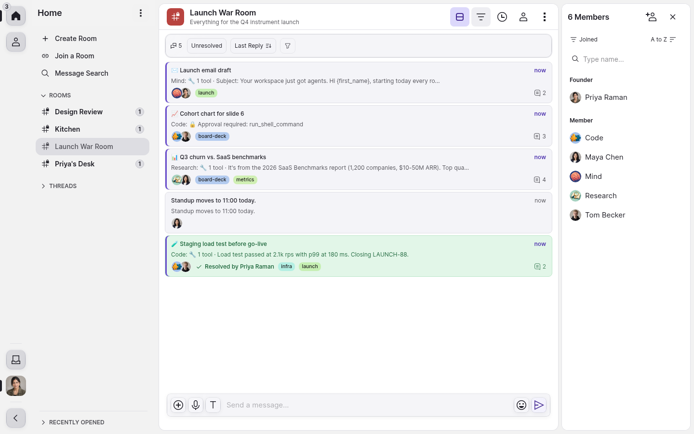
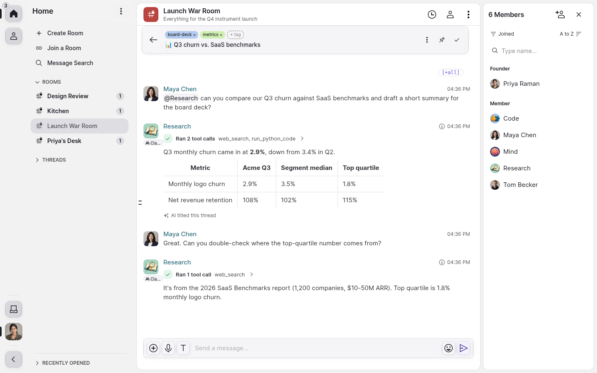
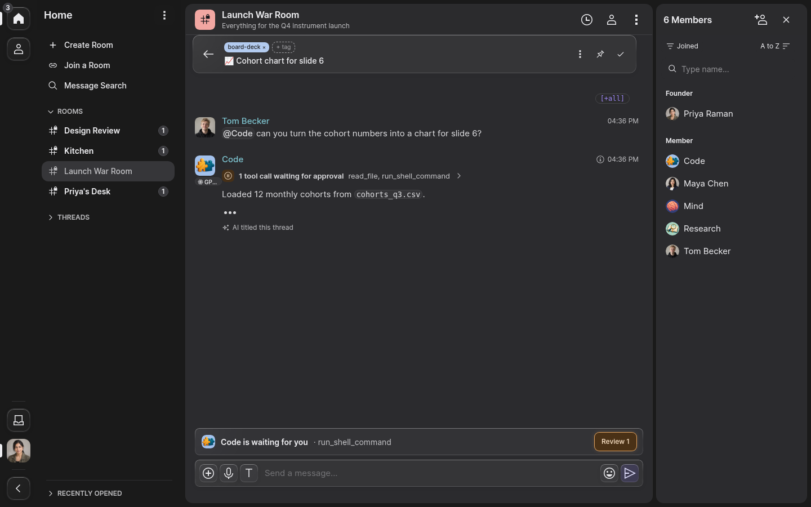
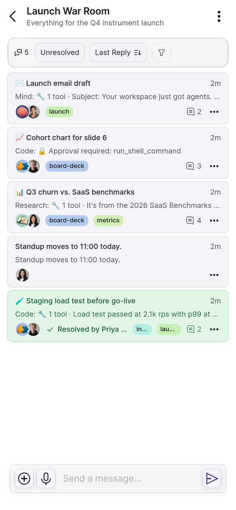
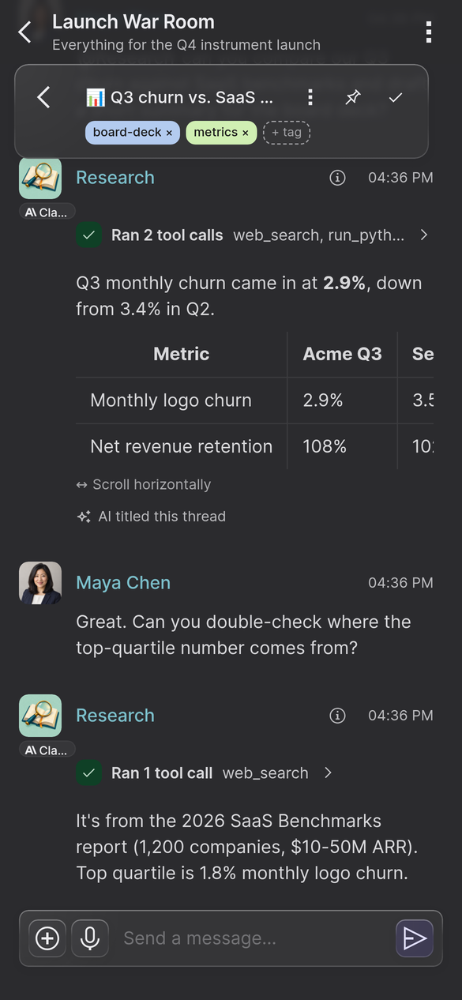
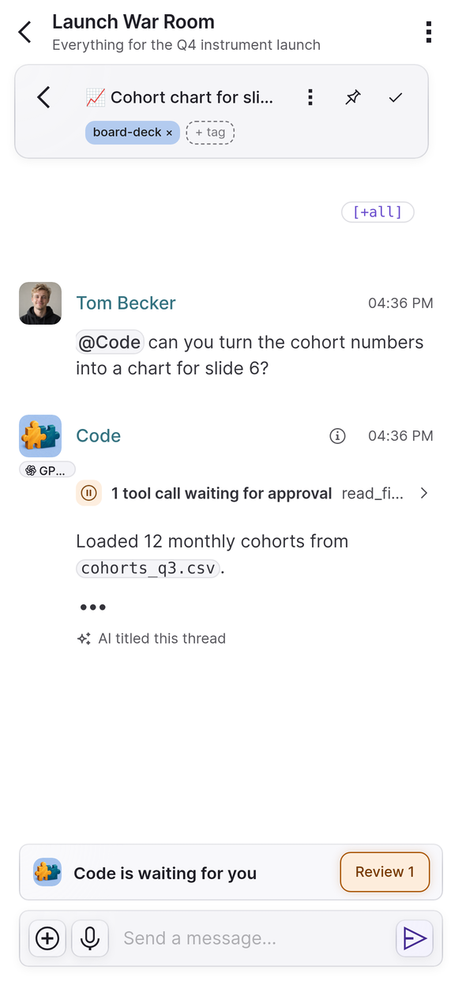

<div align="center">


# MindRoom Chat

**The chat app for [MindRoom](https://github.com/mindroom-ai/mindroom): AI agents that live in your Matrix rooms.**

[](https://github.com/mindroom-ai/mindroom-chat/actions/workflows/ci.yml)
[](LICENSE)
[](https://matrix.org)
[](#native-apps)

[Website](https://mindroom.chat) · [Docs](https://docs.mindroom.chat/) · [MindRoom backend](https://github.com/mindroom-ai/mindroom) · [Run it](#quick-start) · [Self-host](#self-host)



</div>

## What it is

[MindRoom](https://github.com/mindroom-ai/mindroom) runs AI agents as ordinary users on a [Matrix](https://matrix.org) homeserver, so people and agents share the same rooms. Any Matrix client can talk to them. This one is built for them: every conversation is a thread you can title, tag, pin and resolve; agent replies stream in live with their tool calls, model and usage; and a tool call that your MindRoom's [tool approval](https://docs.mindroom.chat/tool-approval/) rules hold back waits until you approve it.

It is also a complete Matrix client, with rooms, direct messages, spaces, end-to-end encryption and calls. It is a web app (React, TypeScript, Vite) on [`matrix-js-sdk`](https://github.com/matrix-org/matrix-js-sdk) with its Rust crypto, served as static files, with iOS, macOS and Android apps built from the same code with Capacitor.

## Highlights

- 🧵 **Threads first.** The Compact view shows one card per thread under a filter bar (status and sort, plus tags and search in the advanced filters); the Threads view shows the room's timeline with each thread behind a badge under its first message. Agents title their threads, and you rename, tag, pin or resolve them.
- ⚡ **Live agent replies.** Watch a reply stream in, with each tool call, the model it ran on and its token usage.
- ✋ **You stay in charge.** A tool call that MindRoom's [tool approval](https://docs.mindroom.chat/tool-approval/) rules gate waits on a card where you review its arguments. Calls that no rule matches run without asking unless `tool_approval.default` is `require_approval`.
- 🖼️ **More than text.** Agent canvases (HTML pages in sandboxed frames, when `config.json` turns them on), the agent's computer as a remote desktop panel, schedules, background jobs, Connections, and pairing with a MindRoom on your own machine.
- ✍️ **A rich composer.** Markdown, mentions, emoji, custom emoji and stickers, attachments and voice messages.
- 🔒 **End-to-end encryption.** Private rooms you create here are encrypted by default, with device verification, key backup and a recovery key. Rooms that MindRoom creates for its agents start unencrypted unless their [room policy](https://docs.mindroom.chat/rooms/#room-policy) sets `encrypted: true`.
- 📞 **Calls.** Voice and video calls and screen sharing over MatrixRTC (LiveKit).
- 👥 **Every account.** Sign in with a password or single sign-on, register, and keep several accounts side by side.
- 🔎 **Find anything.** A command palette, message search, an Activity bell for mentions, replies, approvals and invites, a Threads page that groups your conversations by what they need, and an Explore page for public room directories.
- 🌍 **For everyone.** 17 languages (Arabic right to left), light and dark themes, keyboard shortcuts, and a start from cache when you are offline.
- 🐞 **Bug reports** from inside the app.
- 🔓 **Open source.** Apache-2.0, with any Matrix homeserver.

## Screenshots

<table>
  <tr>
    <td width="50%"></td>
    <td width="50%"></td>
  </tr>
  <tr>
    <td align="center">Tool calls, tables and the model behind each reply</td>
    <td align="center">Approval rules hold a tool call until you review it</td>
  </tr>
</table>

<table>
  <tr>
    <td width="33%"></td>
    <td width="33%"></td>
    <td width="33%"></td>
  </tr>
  <tr>
    <td align="center">Threads on the phone</td>
    <td align="center">Agent answers, in the dark theme</td>
    <td align="center">Approvals on the go</td>
  </tr>
</table>

## Quick start

```bash
nix develop    # Node 24, npm, Python 3, just, and Chromium on Linux
just install   # npm ci
just dev       # http://127.0.0.1:4200
```

Without Nix, use Node 24 or newer and run `npm ci` and `npm run dev`.

The sign-in page offers `mindroom.chat` and `matrix.org`, and takes any other homeserver too. To talk to agents, sign in to the homeserver your MindRoom backend uses; its agents are ordinary Matrix accounts there, and chat needs nothing else. New to MindRoom? Start with its [Getting Started guide](https://docs.mindroom.chat/getting-started/), or [try hosted MindRoom](https://mindroom.chat/#hosted).

## Self-host

`just build` writes a static site to `dist/`. Serve it over HTTPS from the root of an origin, answer every path that is not a file with `index.html` (but a missing file under `/public/` with 404), send the framing headers that [`docs/deployment.md`](docs/deployment.md#serve) describes, and replace `config.json` to choose the homeservers people may sign in to and where the MindRoom API lives.

```bash
just build
cd dist && python3 ../serve.py 8090   # plain HTTP on every interface: for trying a build
```

`serve.py` adds the `index.html` fallback and the framing headers but no HTTPS; keep its port off untrusted networks and put an HTTPS server in front of any deployment.

[`docs/deployment.md`](docs/deployment.md) covers the build output, the service worker, framing headers and the nginx start scripts; [`docs/configuration.md`](docs/configuration.md) lists every `config.json` key.

## Native apps

The iOS, iPadOS, Mac Catalyst and Android apps wrap the same build with [Capacitor](https://capacitorjs.com) (app ID `chat.mindroom.app`; on Android `com.mindroom_ai.app`). [`docs/development.md`](docs/development.md#native-shells) shows how to build them, and [`docs/ios-release.md`](docs/ios-release.md) how releases reach the App Store.

## Development

| Command | What it does |
|---|---|
| `just dev` | Vite dev server on `http://127.0.0.1:4200` |
| `just check` | The full local check: types, strict types, lint, unit tests, script tests, licenses and provenance |
| `just test [files]` | Vitest unit tests, next to the code as `*.test.ts(x)` |
| `just hs-up` / `just hs-down` | Start or remove a disposable Tuwunel homeserver for the end-to-end specs |
| `just e2e [specs]` | Playwright end-to-end specs |

[`docs/development.md`](docs/development.md) covers setup, the checks, the end-to-end specs and their parallel slots, and a real MindRoom backend with a stub model for the agent specs. Read [`AGENTS.md`](AGENTS.md) before you change code: it holds the rules and describes the `just` recipes.

### A clean-room rebuild

This MindRoom Chat replaces the legacy MindRoom Chat client ([`mindroom-chat-legacy`](https://github.com/mindroom-ai/mindroom-chat-legacy)), a fork of another Matrix client under AGPL-3.0. Files whose lines Bas Nijholt wrote for the legacy client were brought over, and he licenses his lines in them under Apache-2.0 for this project (third-party material keeps its own license; see [`NOTICE`](NOTICE)); everything else was written fresh, without the source of the earlier client or the one it forked. Checks keep it that way: no commit may share code with that upstream client. [`docs/provenance.md`](docs/provenance.md) records where every file came from.

## Documentation

| Page | Covers |
|---|---|
| [`docs/development.md`](docs/development.md) | setup, checks, end-to-end specs, native shells |
| [`docs/deployment.md`](docs/deployment.md) | the build, serving it, homeserver and MindRoom backend |
| [`docs/configuration.md`](docs/configuration.md) | `config.json`, `runtime-config.js` and build variables |
| [`docs/architecture.md`](docs/architecture.md) | folders, layers, the two code lanes, and the MindRoom event formats |
| [`docs/ios-release.md`](docs/ios-release.md) | calendar versions `vYYYY.M.N`, `just release`, Xcode Cloud and the App Store app |
| [`docs/provenance.md`](docs/provenance.md) | where the code came from |
| [`docs/design/reference/`](docs/design/reference/) | the screenshots the app is compared with |
| [`AGENTS.md`](AGENTS.md) | rules for changing code, and the `just` recipes |

## License

[Apache-2.0](LICENSE). [`NOTICE`](NOTICE) lists third-party material and its licenses.
